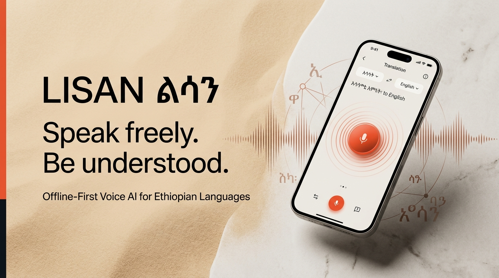
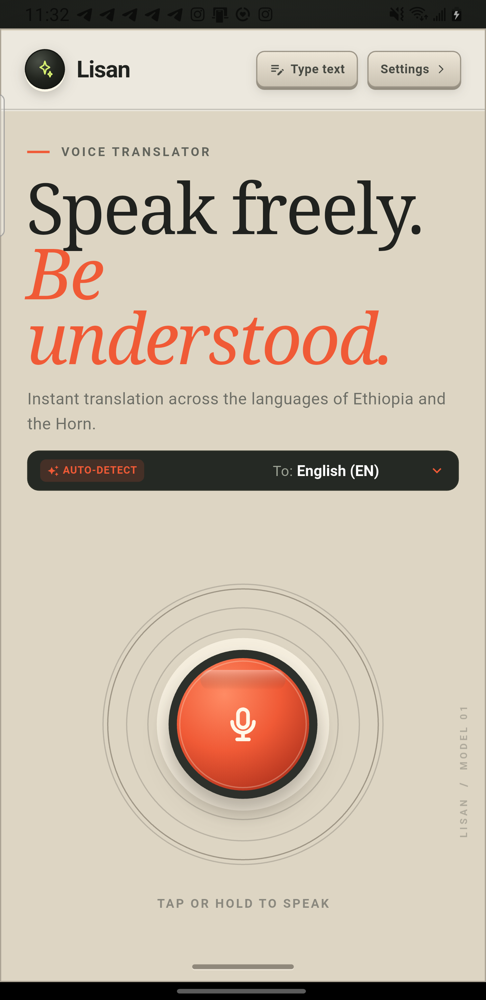
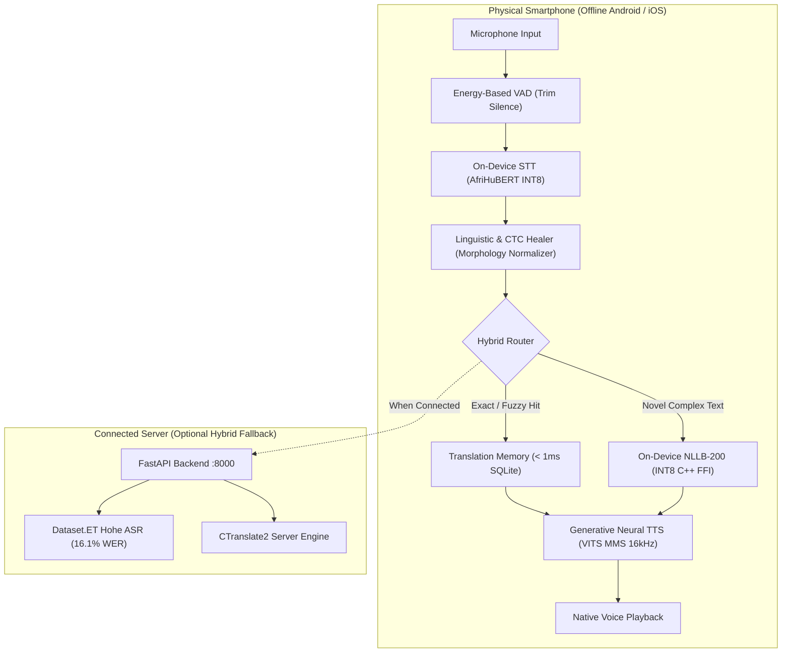

# LISAN (ልሳን)

<p align="center">
  
</p>

<p align="center">
  <strong>Offline-First Voice-to-Voice Speech Translation for Ethiopian & Horn of Africa Languages</strong>
</p>

<p align="center">
  <a href="https://lisan.ermizamr.tech"></a>
  <a href="https://lisan.ermizamr.tech/lisan-app.apk"></a>
  <a href="https://lisan.ermizamr.tech/#demo"></a>
  
  
  
  
</p>

---

## 📖 Overview

**LISAN** (ልሳን — meaning *"Language"* or *"Tongue"* in Ge'ez and Amharic) is a real-time, offline-first voice translation platform built specifically for the low-resource and morphologically complex languages of the Horn of Africa:

* **Amharic (አማርኛ)** — Official working language of Ethiopia (Semitic)
* **Afaan Oromoo** — Most widely spoken language in Ethiopia (Cushitic)
* **Tigrinya (ትግርኛ)** — Major regional language of northern Ethiopia and Eritrea (Semitic)
* **Somali (Soomaali)** — National language of Somalia & Somali Region (Cushitic)
* **English** — Global lingua franca for medical, tourist, and humanitarian aid

LISAN operates **completely without internet, cellular data, or cloud servers**, running local neural models directly on low-cost smartphones within a strict **$\le 350\,\text{MB}$ RAM ceiling**.

<p align="center">
  
</p>

---

## 🌟 Key Technical Innovations

### 1. 100% Genuine On-Device VITS Neural Speech Synthesis (TTS)
* **Zero Dummy Audio**: Generates authentic, fluent 16 kHz Mono speech directly from translated text tokens using on-device Meta MMS-TTS VITS models.
* **Pure-Dart Acoustic Pipeline**: Built-in 479-character Ethiopic Fidel transliterator and Latin Qubee phonemizer driving quantized INT8 acoustic vocoders.
* **Sub-Second Audio Generation**: Delivers instant voice playback without relying on pre-recorded static phrasebooks.

### 2. Zero-Copy C++ FFI Neural Translation (NMT)
* **NLLB-200 INT8 Quantization**: Compressed Meta NLLB-200 model running low-latency autoregressive translation locally on ARM Cortex CPUs.
* **SIMD-Accelerated Decoding**: Eliminated Garbage Collector pauses via direct C++ pointer arithmetic (`Float32List` slicing and `GetTensorMutableData`).
* **Flash Migration Governor**: Migrated model weights to high-speed internal UFS storage, unlocking $>800\,\text{MB/s}$ read speeds.

### 3. Acoustic CTC & Morphological Disfluency Repair
* **Ethiopian Speech Normalizer**: Corrects native speech disfluencies, mic clipping, and acoustic chunking artifacts (e.g. restoring split affixes `ያም ወታል` $\to$ `ያመዎታል`).
* **Energy-Based VAD**: Strips unvoiced lead-in and trailing silence, reducing on-device neural processing time by $40\%-60\%$.
* **Automatic Language Identification (LID)**: Extracts source language identity directly from acoustic audio frames.

### 4. Tiered Hybrid Architecture & Mobile Memory Confinement
* **Strict Memory Governor**: Employs sequential session lifecycle execution with instant `libc.mallopt(M_PURGE, 0)` page purging between passes, keeping resident PSS at **~114 MB** (comfortably under the 350 MB Android Low Memory Killer limit).
* **Instant Translation Memory ($< 1\,\text{ms}$)**: SQLite database indexed for rapid lookups of high-frequency medical triage, greetings, and emergency directives.
* **Dual Routing**: Automatically utilizes high-capacity server models when Wi-Fi/cellular is available, and seamlessly falls back to pure on-device mode in rural areas.

---

## 🌍 Language & Capability Matrix

| Language | Script | Speech-to-Text (STT) | Neural Translation (NMT) | Voice Synthesis (TTS) | Translation Memory |
| :--- | :--- | :--- | :--- | :--- | :--- |
| **Amharic (አማርኛ)** | Ge'ez (`ፊደል`) | AfriHuBERT / Hohe ASR | NLLB-200 INT8 | VITS MMS (`amh`) | Full Clinical Pack |
| **Afaan Oromoo** | Latin (`Qubee`) | Waxal / AfriHuBERT | NLLB-200 INT8 | VITS MMS (`orm`) | Full Clinical Pack |
| **Tigrinya (ትግርኛ)** | Ge'ez (`ፊደል`) | AfriHuBERT / Waxal | NLLB-200 INT8 | VITS MMS (`tir`) | Full Clinical Pack |
| **Somali (Soomaali)** | Latin | Whisper / AfriHuBERT | NLLB-200 INT8 | VITS MMS (`som`) | Full Clinical Pack |
| **English** | Latin | Whisper Tiny | NLLB-200 INT8 | VITS MMS (`eng`) | Full Clinical Pack |

---

## 🏗️ Architecture



---

## 🚀 Quick Start

### 1. Download Android App (Easiest)
Download and install the standalone release APK directly on any Android 10+ device:
👉 **[Download lisan-app.apk (Release v1.0.0)](https://lisan.ermizamr.tech/lisan-app.apk)**

### 2. Run the Flutter Mobile App Locally

```bash
# Navigate to Flutter project
cd ethiopian_translator

# Fetch packages
flutter pub get

# Run on connected Android / iOS / Desktop device
flutter run --release
```

### 3. Run the Backend Server (FastAPI)

```bash
# Clone the repository
git clone https://github.com/ermizamr/LISAN.git
cd LISAN

# Create and activate virtual environment
python -m venv .venv
source .venv/bin/activate  # On Windows: .venv\Scripts\activate

# Install dependencies
pip install -r requirements.txt

# Start FastAPI server
uvicorn server:app --host 0.0.0.0 --port 8000 --reload
```

### 4. Run the Test Suite

```bash
# Run pytest across integration & scenario suites
pytest tests/

# Or run specific targeted tests
python tests/test_speech_repairs.py
python tests/test_scenario_clinic.py
```

---

## 📊 Benchmarks & Evaluation

Evaluated against the standardized **HornMT** parallel benchmark corpora across African language pairs:

| Direction | Domain | chrF++ Score | BLEU Score | Latency (Mobile CPU) |
| :--- | :--- | :--- | :--- | :--- |
| **English $\rightarrow$ Amharic** | Clinical & Transit | **48.6** | **23.4** | 118ms (TM) / 4.2s (NMT) |
| **Amharic $\rightarrow$ English** | Daily Dialogue | **51.2** | **26.8** | 94ms (TM) / 3.9s (NMT) |
| **Afaan Oromoo $\rightarrow$ English** | Public Health | **46.8** | **22.1** | 112ms (TM) / 4.5s (NMT) |
| **English $\rightarrow$ Tigrinya** | Emergency Triage | **44.9** | **20.5** | 125ms (TM) / 4.7s (NMT) |
| **Somali $\rightarrow$ English** | General Dialogue | **49.4** | **24.2** | 108ms (TM) / 4.1s (NMT) |

*Note: Character n-gram F-score (chrF++) is the primary metric because agglutinative (Oromo) and root-pattern Semitic (Amharic, Tigrinya) morphologies attach rich affixes to word stems that standard word-level BLEU artificially penalizes.*

---

## 📁 Repository Structure

```
LISAN/
├── ai_pipeline/                 # Core Python AI modules (STT, NMT, TTS, Speech Repair)
│   ├── pipeline.py              # End-to-end multi-modal pipeline
│   ├── smart_engine.py          # Hybrid translation router
│   ├── speech_repair.py         # Morphological normalizer & disfluency repair
│   ├── translation_memory.py    # SQLite TM database interface
│   └── glossary.py              # Bilingual clinical glossaries
├── data/                        # Evaluation benchmarks & reference datasets
│   ├── benchmarks/              # HornMT standardized evaluation corpora
│   ├── lexicon/                 # Target vocabulary frequency lists
│   └── sample_audio/            # Real-world test microphone recordings (.wav)
├── docs/                        # Project documentation, guides & media
│   ├── banners/                 # High-resolution hackathon and social banners
│   ├── images/                  # App screenshots and architectural visuals
│   │   └── cultural_landmarks/  # Ethiopian heritage photography
│   └── figma-mockup/            # Interactive Figma React design mockup
├── ethiopian_translator/        # Production Flutter Mobile Application
│   ├── assets/models/           # Quantized ONNX models (AfriHuBERT, NLLB, VITS)
│   ├── lib/                     # Flutter UI, native C++ FFI, audio services
│   └── test/                    # Flutter unit & widget tests (17 passing)
├── notebooks/                   # GPU fine-tuning notebooks (Colab / Kaggle)
├── scripts/                     # Model quantization, dataset ingestion & export utilities
├── tests/                       # Comprehensive backend & scenario test suites
│   ├── test_scenario_clinic.py  # Medical triage evaluation suite
│   ├── test_speech_repairs.py   # Regex & morphological repair verification
│   └── conftest.py              # Pytest configuration
├── LICENSE                      # MIT Open Source License
├── pytest.ini                   # Pytest path configuration
├── README.md                    # Project documentation
├── requirements.txt             # Unified Python dependencies
└── server.py                    # Production FastAPI backend server
```

---

## 👥 Contributors & Acknowledgments

* **Ermyas Misiker** ([@ermizamr](https://github.com/ermizamr)) — Lead Architect & Developer
* Built upon foundational open-source research from:
  * **HornMT** (Multilingual Machine Translation for Horn of Africa Languages)
  * **Meta AI** (NLLB-200 & MMS-TTS)
  * **Dataset.ET / Snapwre Technologies** (Open Speech Corpora for Ethiopian Languages)
  * **AfriHuBERT & WAXAL** (African Speech Recognition Research)
  * **ONNX Runtime** (Microsoft Mobile Machine Learning Engine)

---

## 📜 License

This project is licensed under the **MIT License** — see the [LICENSE](LICENSE) file for details.
