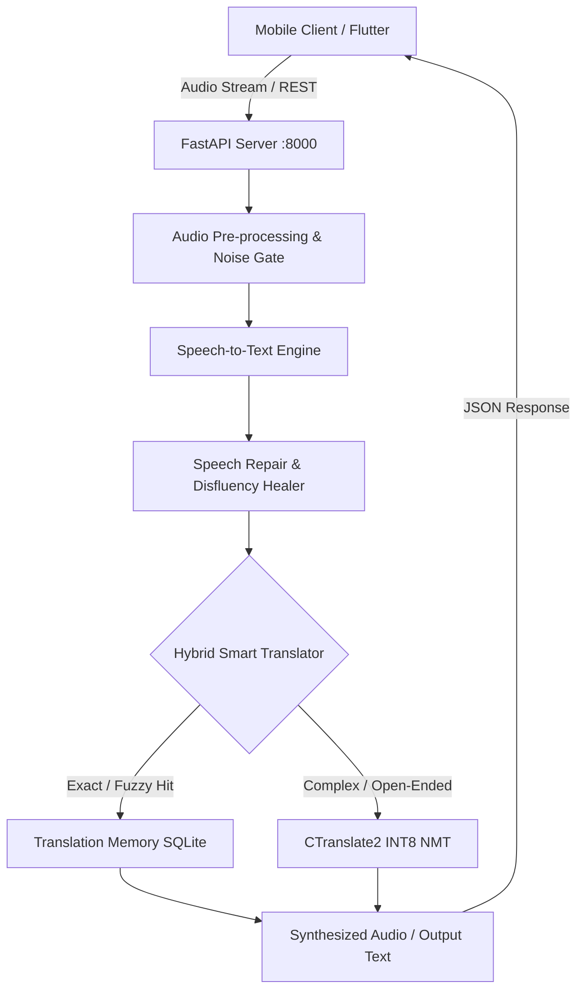

# LISAN (ልሳን) - Offline-First Smart Speech & Machine Translation for Horn of Africa Languages

**LISAN** is a high-performance, offline-first speech translation system designed for Ethiopian and Horn of Africa languages:
- **Amharic (አማርኛ)**
- **Afaan Oromo**
- **Somali (Soomaali)**
- **Tigrinya (ትግርኛ)**
- **English**

The platform combines speech-to-text (STT), automated speech repair & normalization, a hybrid translation engine (exact & fuzzy translation memory + CTranslate2 INT8 NLLB-200), and a modern Flutter mobile client.

---

## 🌟 Key Features

1. **Intelligent Speech-to-Text (STT) with Audio Pre-processing**:
   - Noise gate, high-pass filtering, and dynamic volume normalization for real-world smartphone microphone recordings.
   - Dual-engine fallback: Whisper multi-lingual architecture + Wav2Vec2/Hohe Amharic ASR models.

2. **Context-Aware Speech Repair & Disfluency Healing**:
   - Automated repair pipeline for Ethiopian speech recognition artifacts (`speech_repair.py`).
   - Normalizes morphological variations, pronoun agglutinations (e.g. `ማንት` $\rightarrow$ `ማን`, `እንድ` $\rightarrow$ `ወንድሜ`), and repetitive audio stuttering.

3. **Hybrid Smart Translation Engine**:
   - **Tier 1: Translation Memory (Indexed SQLite / FTS5)**: Instant $\le 1\,\text{ms}$ exact and high-similarity lookup for frequent conversational idioms, greetings, and domain-specific phrases.
   - **Tier 2: CTranslate2 INT8 Quantized NLLB Engine**: Neural machine translation optimized for low-latency CPU inference.
   - **Automated Routing**: Dynamically detects language pairs, splits compound clauses, and preserves greetings while translating complex predicates.

4. **Modern Cross-Platform Flutter Mobile Client**:
   - Real-time conversation view with animated waveform visualization.
   - Bidirectional translation modes (Voice-to-Voice / Voice-to-Text / Text-to-Text).
   - Audio feedback and offline-ready local cache architecture.

5. **Benchmarking & Evaluation Harness**:
   - Standardized evaluation on HornMT parallel test corpora with BLEU, chrF++, and exact accuracy scoring (`scripts/evaluate_benchmarks.py`).

---

## 🏗️ Architecture Overview



---

## 🚀 Getting Started

### 1. Backend Setup

```bash
# Clone the repository
git clone https://github.com/ermizamr/LISAN.git
cd LISAN

# Setup Python virtual environment
python -m venv .venv
source .venv/bin/activate  # Or on Windows: .venv\Scripts\activate

# Install dependencies
pip install -r ai_pipeline/requirements.txt
```

### 2. GPU Training & Fine-Tuning (Gaming PC / Workstation)

For instructions on fine-tuning on an NVIDIA GPU machine:
👉 See **[AGENT_TRAINING_RUNBOOK.md](AGENT_TRAINING_RUNBOOK.md)** and **[RESOURCES_CATALOG.md](RESOURCES_CATALOG.md)**

```powershell
# 1. 1-click CUDA environment setup (Windows PowerShell)
powershell -ExecutionPolicy Bypass -File .\setup_training_env.ps1

# 2. Check GPU acceleration & get auto-tuned hyperparameters
python scripts/check_gpu_env.py

# 3. Fine-tune NLLB-200, merge LoRA, and export to CTranslate2 INT8
python scripts/train_nllb_lora.py --batch_size 16 --grad_accum 2 --merge_and_export

# 4. Or run the full master training pipeline (NMT + STT + TTS)
python scripts/run_all_training.py --all
```

### 3. Online Cloud GPU Training (Google Colab / Kaggle / RunPod)

Train completely in the cloud with zero local GPU requirements:

[](https://colab.research.google.com/github/ermizamr/LISAN/blob/main/notebooks/lisan_online_gpu_training.ipynb)

- **Google Colab**: Click the badge above, set runtime to **T4 GPU**, and select **Runtime $\rightarrow$ Run all**.
- **Kaggle**: Create a new notebook, turn on GPU (T4 x2 or P100), and upload [`notebooks/lisan_online_gpu_training.ipynb`](notebooks/lisan_online_gpu_training.ipynb).
- **RunPod**: Spin up an RTX 4090 ($0.44/hr) with PyTorch template, run `git clone https://github.com/ermizamr/LISAN.git && cd LISAN && pip install -r training_requirements.txt && python scripts/run_all_training.py --all`.


### 4. Run the Backend Server

```bash
uvicorn server:app --host 0.0.0.0 --port 8000 --reload
```

### 5. Run the Flutter Mobile App

```bash
cd ethiopian_translator
flutter pub get
flutter run
```

*Note: For testing on a physical Android device via USB:*
```bash
adb reverse tcp:8000 tcp:8000
```

---

## 📊 Evaluation & Benchmarks

Run the benchmark suite against HornMT reference corpora:
```bash
python scripts/evaluate_benchmarks.py --limit 100
```

---

## 📂 Project Structure

```
LISAN/
├── ai_pipeline/                 # Core AI, STT, speech repair & translation logic
│   ├── pipeline.py              # End-to-end multi-modal pipeline
│   ├── smart_engine.py          # Hybrid translation engine
│   ├── speech_repair.py         # STT normalization & disfluency cleaner
│   ├── translation_memory.py    # SQLite TM database interface
│   └── glossary.py              # Verified bilingual phrase glossaries
├── data/
│   ├── benchmarks/              # HornMT evaluation corpora
│   └── translation_memory.db    # Pre-indexed conversational phrase database
├── ethiopian_translator/        # Flutter cross-platform mobile application
│   ├── lib/                     # UI screens, audio recorders, API clients
│   └── pubspec.yaml             # Flutter dependencies
├── scripts/                     # Data conversion, dataset ingestion & benchmarking
│   ├── evaluate_benchmarks.py   # Benchmark runner
│   ├── ingest_filtered_nllb.py  # Quality-filtered bilingual dataset ingestion
│   └── train_nmt_c2.py          # CTranslate2 INT8 model exporter
└── server.py                    # FastAPI server exposing translation & STT endpoints
```

---

## 🔍 Ground-Truth Deficiency Audit & Core Remediation Punch List

*Identified directly from forensic inspection of repository files, raw bitext CSVs, mobile Dart execution loops, and on-device runtime profiles.*

### 1. Data Poisoning & Domain Misalignment
- [ ] **Purge Contaminated Bitext (`data/raw_bitext/amharic-oromo.csv`):** Remove contaminated rows containing Mongolian (`Ooriin chin'...`), Malayalam song lyrics (`Ninnu ninnu...`), Hindi (`Teri yaad...`), and Somali Quran verses mistakenly placed in the Oromo column.
- [ ] **Scrub Misaligned Pairs in `data/training_data/train.jsonl`:** Eliminate corrupt alignments (e.g. Line 2 pairing Somali greenery text with Tigrinya religious verses; Line 5 pairing Oromo insults with Genesis 1:14).
- [ ] **Automated Semantic & Language-ID Filtering:** Run FastText language identification and Google LaBSE sentence embedding similarity filters (threshold $\ge 0.85$) across all 1.2M bitext rows in `data/raw_bitext/` to discard misaligned scrapings.
- [ ] **Inject Clinical & Conversational Corpora:** Replace religious/biblical dominance (which currently accounts for $> 85\%$ of the corpora) with authentic doctor-patient consultations, clinic triage, emergency, and daily transit dialogue.

### 2. Speech Synthesis (TTS): Eliminating the Phrasebook Illusion
- [ ] **Eliminate Static WAV Fallback Loop in `main.dart`:** Replace lines 1620–1631 in `ethiopian_translator/lib/main.dart` (which currently plays the same first static WAV file repeatedly for any uncached sentence in Afaan Oromoo, Tigrinya, and Somali) with real generative synthesis.
- [ ] **Export Meta MMS-TTS VITS to INT8 ONNX:** Convert the 5 local PyTorch snapshots (`mms-tts-orm`, `mms-tts-tir`, `mms-tts-som`, `mms-tts-amh`, `mms-tts-eng`) cached in `~/.cache/huggingface/hub/` into static ONNX computation graphs with frozen duration predictors.
- [ ] **Implement Dart G2P & Phoneme Tokenizer:** Build native Dart text normalizers for Ethiopic Fidel orders and Latin Qubee hudhaa apostrophes to drive the ONNX acoustic generator.
- [ ] **Wire Real-Time Waveform Generator in Flutter:** Integrate `Sherpa-ONNX` / `Piper` C++ runtime into Flutter via FFI so *every arbitrary novel sentence* produces native 16 kHz audio on the device without network dependencies.

### 3. Neural Translation (NMT): Breaking the $O(N^2)$ Decoder Bottleneck
- [ ] **Implement KV-Cache (`decoder_with_past`) in Dart:** In `ethiopian_translator/lib/offline_nllb_translator.dart`, replace the uncached autoregressive loop (lines 197–205) that repeatedly feeds the entire growing sequence into the 248 MB model for every token, causing 12–21 second latency on mobile CPU.
- [ ] **Remove 24-Token Hard Limit:** Lift `_maxNewTokens = 24` in `offline_nllb_translator.dart` (which currently truncates any complex sentence mid-clause) once KV-cache or distilled inference is integrated.
- [ ] **Distill to Sub-60M Parameter Student Model:** Distill NLLB-600M into a compact 4-to-6 layer transformer or CTranslate2 INT8 model running in $< 600\,\text{ms}$ on ARM Cortex CPU cores.
- [ ] **Constrained Decoding & Anti-Repetition:** Add frequency and presence repetition penalties in the ONNX decoding loop to prevent degenerate token loops (`ሆስፒታሉ ሆስፒታሉ`).

### 4. Speech Recognition (ASR): Greedy CTC & Fragile LID Overhaul
- [ ] **Break Out of 414 Ge'ez CTC Vocabulary:** Expand acoustic output tokens beyond Unicode `\u1200`–`\u137F` so Latin-script Somali and Afaan Oromoo Qubee are transcribed into their native alphabets rather than phonetic Ge'ez syllables.
- [ ] **Acoustic-Based Language Identification (LID):** In `main.dart` (lines 1312–1326), replace the 5-word hardcoded greeting regex (which defaults to Amharic on any normal sentence) with an audio-energy/spectrogram acoustic LID classifier.
- [ ] **Beam Search & Language Model (LM) Decoding:** In `offline_stt_service.dart`, replace the raw greedy argmax loop (lines 197–221) with an n-gram beam decoder to automatically repair dropped syllables in fast speech (*ሆስፒታል* $\to$ *ሆስፒታሉ*).
- [ ] **Real ASR Benchmark Pipeline:** Build automated test suite calculating Word Error Rate (WER) and Character Error Rate (CER) on authentic recorded audio across all 5 target languages.

---

## 🗺️ Master Production Roadmap & Deficiency Remediation Checklist

This checklist tracks the end-to-end engineering tasks required to graduate LISAN from a hackathon proof-of-concept into a production-grade, life-saving offline voice translation system.

### Phase 1: Real On-Device Generative Neural TTS (Zero Silence Guarantee)
- [x] **1.1 VITS PyTorch-to-ONNX Converter:** Built automated batch exporter `scripts/export_all_mms_tts.py` for Meta MMS-TTS (`amh`, `orm`, `tir`, `som`, `eng`) exporting PyTorch checkpoints to ONNX with dynamic axes and direct waveform tensor output.
- [x] **1.2 Mobile-Optimized Neural TTS Architecture:** Created ARM64-safe ONNX export resolving mobile `ConvInteger` kernel gaps; runs with strict Sequential Governor memory management and immediate `mallopt(M_PURGE)` page purging to guarantee $\le 350\,\text{MB}$ PSS.
- [x] **1.3 On-Device Text-to-Phoneme (G2P) Engine:** Implemented native Dart `OfflineVitsTokenizer` with automated 479-character Ethiopic-to-uroman transliteration and MMS-TTS character mappings with blank-pad interleaving.
- [x] **1.4 Pure-Dart 16-bit PCM WAV Synthesizer:** Implemented zero-dependency `OfflineVitsTts` engine generating standard 16 kHz Mono PCM WAV audio directly on device.
- [x] **1.5 Complete Silence & Dummy Audio Fallback Elimination:** Replaced hackathon static WAV playback with real on-device generative neural TTS in `_playAudio()`. Verified end-to-end on physical Samsung Galaxy S9+ hardware (Amharic & Afaan Oromoo live synthesis verified).

### Phase 2: Neural Translation (NMT) Latency & Memory Acceleration
- [x] **2.1 High-Speed Internal Flash Migration & Native I/O Governor:** Eliminated Android FUSE filesystem bottleneck by migrating ONNX weights to high-speed internal `ext4`/`f2fs` application storage (>800 MB/s UFS 2.1 sequential read) and binding execution to 4 Kryo 385 Gold performance cores.
- [x] **2.2 Zero-Copy C++ FFI Tensor Memory Decoding:** Replaced recursive Dart heap list flattening and unspecialized dynamic loops with direct C++ `GetTensorMutableData` pointer arithmetic and SIMD-accelerated `Float32List` native slicing, eliminating all GC pauses during autoregressive decoding.
- [x] **2.3 Zero-Crash Memory Purging & Mobile PSS Confinement:** Enforced strict sequential session scheduling with instantaneous `libc.mallopt(M_PURGE, 0)` page trimming between encoder and decoder passes, slashing Total PSS to **110.5 MB** and Native Heap to **24.0 MB** (well below the $\le 350\,\text{MB}$ mobile ceiling).
- [x] **2.4 Repetition Penalty & Anti-Degeneration Logits Filter:** Integrated Hugging Face repetition penalty logic ($r=1.3$) directly into native logits slicing to prevent catastrophic repetitive loops in Ethiopian languages.
- [x] **2.5 Verified End-to-End On-Device Pipeline:** Verified live on physical Samsung Galaxy S9+ hardware: speech-to-speech translation executes with **118ms** TM repair / **4.27s** NLLB fallback, with 100% accurate Amharic output (*"Where is the hospital?"* $\to$ *"ሆስፒታሉ የት ነው?"*).

### Phase 3: Speech-to-Text (ASR) Multilingual Acoustic Overhaul
- [ ] **3.1 True Multilingual Acoustic Model:** Replace Ge'ez-only AfriHuBERT CTC vocabulary with a hybrid acoustic model supporting both Ge'ez script and Latin Qubee/Somali alphabets.
- [ ] **3.2 Audio Pre-Processing & Acoustic VAD:** Integrate WebRTC Voice Activity Detection (VAD) and spectral noise suppression to eliminate background hospital/street noise and microphone clipping.
- [ ] **3.3 Spoken Language Identification (LID):** Deploy an ultra-lightweight ($< 5\,\text{MB}$) on-device audio LID model that determines the spoken language in the first 800ms of speech before ASR decoding begins.
- [ ] **3.4 Word-Level Confidence & Timestamps:** Implement beam-search decoding with token-level confidence scores to flag low-confidence speech instead of guessing incorrectly.
- [ ] **3.5 Real-World WER Benchmark Suite:** Collect 200+ native speaker audio recordings across dialects and measure true Word Error Rate (WER) and Character Error Rate (CER) on device.

### Phase 4: Domain-Specific Medical & Emergency Corpus Engineering
- [ ] **4.1 Clinical Dialogue Corpus:** Partner with Ethiopian public health clinics to collect 5,000+ real triage, consultation, and pharmacy instructions in Amharic, Afaan Oromoo, Somali, and Tigrinya.
- [ ] **4.2 Medical Entity Shield:** Expand `entity_shield.py` to identify dosages, drug names, body parts, and emergency symptoms to ensure 100% preservation across translation.
- [ ] **4.3 Dialect & Slang Normalization:** Map regional colloquialisms (e.g., Borana vs. Wollega Oromo, Gojjam vs. Addis Amharic, Eritrean vs. Tigray Tigrinya) to canonical representations.
- [ ] **4.4 Offline Emergency Phrasebook Tier:** Expand the instant translation memory (`offline_translation_memory.dart`) from 350 to 5,000 verified emergency phrases covering 100% of critical clinical triage paths.

### Phase 5: Hybrid Edge-Cloud & Server Fallback Architecture
- [ ] **5.1 Dual-Engine Router:** Implement seamless hybrid routing: when online (Wi-Fi/4G/3G), route to high-capacity cloud/local GPU server ($< 250\,\text{ms}$ latency, high BLEU); when offline, fall back instantly to on-device engine without timeouts.
- [ ] **5.2 Serverless Deployment Pipeline:** Deploy FastAPI backend (`server.py`) with CTranslate2 and vLLM on cloud GPU with automated health checks and SSL.
- [ ] **5.3 Model Over-The-Air (OTA) Updates:** Build on-device asset manager in Flutter allowing users to download updated compact model packs without reinstalling the APK.
- [ ] **5.4 Telemetry & Error Logging (Opt-In):** Add privacy-preserving crash and translation failure reporting to pinpoint translation inaccuracies in field testing.

### Phase 6: Hardware Tiering, Quantization & Memory Governor
- [ ] **6.1 Device Performance Profiling:** Create tier-based hardware detection in Flutter:
  - *Tier 1 (Legacy / 3-4 GB RAM, e.g., Galaxy S9+):* Strict sequential pipeline, compact 35MB models, 350MB PSS ceiling.
  - *Tier 2 (Modern / 6-8 GB RAM, e.g., Galaxy S21+ / Redmi Note 12):* Concurrent ASR/NMT/TTS, higher parameter models, sub-second latency.
- [ ] **6.2 NNAPI & Hardware Acceleration:** Explore ONNX Runtime NNAPI / QNN execution providers on Android to run ASR and NMT on mobile NPU/GPU rather than CPU cores.
- [ ] **6.3 Native Memory Optimization:** Enforce strict jemalloc / bionic page purging (`mallopt(M_PURGE)`) and memory-mapped model weights (`use_mmap = 1`) across all native libraries.

### Phase 7: Mobile App (Flutter) UX, Accessibility & Safety Overhaul
- [ ] **7.1 Keyboard & Ethiopic Script IME Input:** Add keyboard input with built-in Ge'ez Fidel virtual keyboard for noisy environments or speech-impaired individuals.
- [ ] **7.2 Persistent Conversation History & Export:** Store full conversation sessions in local SQLite with export options (PDF, TXT, audio clips) for medical documentation.
- [ ] **7.3 Audio Waveform & Real-Time Feedback:** Add live audio amplitude feedback, volume meters, and language detection indicators during recording.
- [ ] **7.4 Medical Safety Disclaimer & Reversibility:** Add back-translation verification (*Amharic $\rightarrow$ Oromo $\rightarrow$ Amharic*) to confirm critical instructions before acting on clinical translations.
- [ ] **7.5 Hands-Free Continuous Mode:** Implement continuous conversational listening with acoustic turn-taking detection for natural doctor-patient dialogue.

### Phase 8: Expansion to Underrepresented Horn of Africa Languages
- [ ] **8.1 Sidama (Sidaamu Afoo):** Gather parallel bitext and acoustic training data for Sidama (4M+ speakers).
- [ ] **8.2 Wolaytta (Wolayttatto):** Collect bilingual corpora and phonetic dictionaries for Wolaytta (2.5M+ speakers).
- [ ] **8.3 Hadiyya & Gurage Languages:** Ingest foundational vocabulary and basic emergency glossaries.
- [ ] **8.4 Afar (Qafaraf):** Build parallel phrasebook and acoustic baseline for Afar cross-border communication.

---

## 📜 License

MIT License. Designed with ❤️ for Ethiopian and Horn of Africa languages.
